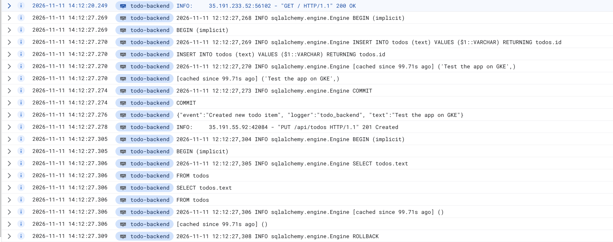

# The "Project" app (a.k.a. the "Todo" app)

## GitOps with Argo CD (exercise 4.8+)
From exercise 4.8 onwards, the project is deployed by Argo CD; a push to the repo triggers the deployment.

## Prometheus (exercise 4.3)
The query in exercise 4.3 is `count(kube_pod_info{namespace="prometheus", created_by_kind="StatefulSet"})`. (This entry is on the top of the README only for the 4.3 release.)

## Deployment (exercise 1.2)
The exercise 1.2 version of the app can either be build locally or pulled from Docker Hub. The image can be found at [juhamyllari/todo-app](https://hub.docker.com/r/juhamyllari/todo-app).

```bash
kubectl create deployment todo-deployment --image=juhamyllari/todo-app:v5
```

## Deployment (exercise 1.4)
The exercise 1.4 version of the app is deployed using the `deployment.yaml` manifest file. The image can be found at [juhamyllari/todo-app](https://hub.docker.com/r/juhamyllari/todo-app).

```bash
kubectl apply -f manifests/deployment.yaml
```

## Deployment (exercise 1.6)
The exercise 1.6 version of the app is deployed using the `deployment.yaml` manifest file and the `service.yaml` manifest file. Port forwarding is used to access the app from the local machine. 

```bash
kubectl port-forward service/todo-svc 30080:80 &
kubectl apply -f manifests/deployment.yaml
kubectl apply -f manifests/service.yaml
```

## Deployment (exercise 1.8)
The exercise 1.8 version of the app is deployed by applying the manifest directory:

```bash
kubectl apply -f manifests/
```

## Deployment (exercises 1.12, 1.13, 2.2, 2.4, 2.6, 2.8, 2.9, 2.10)
The local persistent volume requires the existence of the `/tmp/kube` directory on `k3d-k3s-default-agent-0`. The app is deployed by applying the manifest directory:

```bash
kubectl apply -f manifests/
```

## Deployment (exercise 3.5+)
From exercise 3.5 onwards, the project uses Kustomize.

## Deployment (exercise 3.6+)
Pushing to the `main` branch triggers a GitHub Actions workflow that builds and pushes the images and deploys the app.

Kustomize generates the `postgres-secret` Secret from a gitignored `postgres-secret.env` file.
In CI the file is written from the `POSTGRES_PASSWORD` GitHub secret.

## Deployment (exercise 3.7+)
The workflow runs on a push to any branch. The `main` branch deploys to the `project` namespace;
any other branch deploys to a namespace named after the branch (the branch name must be a valid namespace name).
The workflow sets the namespace with `kustomize edit set namespace`, so the manifests do not hardcode one.
Namespaces are not yet removed automatically in exercise 3.7 when a branch is deleted – this will be done in exercise 3.8.

## Cleanup of branch deployments (exercise 3.8+)
Deleting a branch triggers `.github/workflows/cleanup.yaml`, which deletes the branch's namespace.
Only namespaces labelled `deployed-by=branch-pipeline` (set by a Kustomize patch) are deleted, and `project` is never deleted.

## Broadcaster (exercise 4.6)
The backend publishes an event (`created` or `updated`, plus the todo id, never the todo text) to NATS on every save or update.
The `broadcaster` Deployment (6 replicas) subscribes in a NATS queue group, so each event is handled by exactly one replica,
and forwards a fixed-vocabulary message such as `A todo was created (id 7)` to a webhook. Delivery is at-most-once.
`nats.yaml`, `broadcaster.yaml` and `webhook-sink.yaml` are part of the kustomization;
the sink is an echo server that logs what it receives, a stand-in for an external service.

The webhook target comes from the `broadcaster-secret` Secret, which Kustomize generates from a gitignored `broadcaster-secret.env`:
```
WEBHOOK_URL=http://webhook-sink-svc/
WEBHOOK_FORMAT=generic
```
`WEBHOOK_FORMAT` is `generic` (`{"user", "message"}`) or `discord` (`{"username", "content"}`).
For a local `kubectl apply -k .`, create the file yourself with the values above (this targets the in-cluster sink).
In CI the file is written from the `DISCORD_WEBHOOK_URL` GitHub secret, with the format set to `discord`.
The URL is a credential, so keep it out of the repo.

Watch the sink: `kubectl -n project logs -f deploy/webhook-sink`.

## GitOps with Argo CD (exercise 4.8)
The project is deployed by Argo CD, not by the workflow. `argocd/project-app.yaml` (applied once with `kubectl apply -f`)
makes Argo CD track `the_project/` on `main` and sync it to the `project` namespace, with automated prune and self-heal.
The workflow `.github/workflows/project.yaml` builds and pushes the images on every push; on `main` it also commits the new image tags
to `kustomization.yaml` (`[skip ci]`), and Argo CD deploys that commit. Other branches only build images and are no longer deployed.

The earlier Kustomize secret generators are gone, since Argo CD builds from git where the gitignored `.env` files do not exist.
Create these in the `project` namespace by hand before the first sync (`scripts/create-cluster.sh` does it):
```bash
kubectl create namespace project
kubectl -n project create secret generic postgres-secret --from-literal=POSTGRES_PASSWORD=...
kubectl -n project create secret generic broadcaster-secret --from-literal=WEBHOOK_URL=... --from-literal=WEBHOOK_FORMAT=discord
kubectl -n project create configmap backup-config --from-literal=BACKUP_BUCKET=<bucket name>
```
Changing a secret no longer restarts pods automatically; run `kubectl -n project rollout restart deploy/<name>`.
The text above about CI writing env files and per-branch namespaces describes the earlier setup.

## Exercise 3.9: DBaaS vs DIY
When deploying an app to Google Cloud, we have a choice between using a managed database service (DBaaS) or deploying our own database (DIY). The DIY option is cheaper and keeps the database under the team's control. DIY also offers a portability benefit, as the app setup is defined in its entirety by a collection of Kubernetes manifests and can be deployed to any Kubernetes cluster. However, DIY requires more work to set up and maintain, and the team must have the necessary expertise to do so. No automated backups are provided; the team must implement their own backup solution.

The DBaaS option is easier to set up and maintain, and backups can be handled automatically. The main drawback is the additional cost. DBaaS is also less flexible; the team does not have true superuser access to the database. DBaaS may somewhat contribute to vendor lock-in, but this is not a major concern as data can still be exported in the same way as from any other database.


## Exercise 3.10: Daily database backups to Cloud Storage
`manifests/backup-cronjob.yaml` runs daily at 03:00 UTC. An init container (`postgres:16-alpine`) runs `pg_dump -Fc` into an `emptyDir`,
then the main container (`google/cloud-sdk`) uploads the file to `gs://<bucket>/<namespace>/tododb-<timestamp>.pgdump`.
The upload is authorised with Workload Identity Federation for GKE: the pod runs as the Kubernetes ServiceAccount `db-backup`,
which is granted write access to the bucket directly in IAM. No key file is stored.

One-time setup:
```bash
export PROJECT_ID=<your GCP project ID>
export PROJECT_NUMBER=$(gcloud projects describe $PROJECT_ID --format='value(projectNumber)')
export BUCKET=<globally unique bucket name, e.g. $PROJECT_ID-todo-db-backups>

# Workload Identity must be enabled on the cluster; this prints $PROJECT_ID.svc.id.goog if it is
# (if empty, see "Cluster creation" below for enabling it on an existing cluster)
gcloud container clusters describe dwk-cluster --zone europe-north1-b --format='value(workloadIdentityConfig.workloadPool)'

gcloud storage buckets create gs://$BUCKET --location=europe-north1 --uniform-bucket-level-access

# Allow the db-backup ServiceAccount of the `production` namespace to write objects in the bucket only.
# objectCreator is not enough: `gcloud storage cp` also needs storage.objects.get to check the destination.
gcloud storage buckets add-iam-policy-binding gs://$BUCKET \
  --role=roles/storage.objectUser \
  --member="principal://iam.googleapis.com/projects/$PROJECT_NUMBER/locations/global/workloadIdentityPools/$PROJECT_ID.svc.id.goog/subject/ns/production/sa/db-backup"
```
The IAM binding names a namespace, so only the `production` namespace can upload. Backup jobs in branch namespaces fail with a permission error unless an equivalent binding is added for them.
The bucket name is not committed. Kustomize generates the `backup-config` ConfigMap from a gitignored `backup-config.env` file
containing `BACKUP_BUCKET=<bucket name>` (no `gs://`). In CI the file is written from the `BACKUP_BUCKET` GitHub secret.
For a local `kubectl apply -k .`, create the file yourself.

Test it without waiting for the schedule:
```bash
kubectl -n production create job --from=cronjob/db-backup db-backup-test
kubectl -n production logs job/db-backup-test -c upload
```

### Cluster creation
The cluster is not defined in the repo, so its creation command is recorded here. `--workload-pool` is required for the backups:
it enables Workload Identity and makes new node pools use the GKE metadata server.
```bash
gcloud container clusters create dwk-cluster --zone=europe-north1-b --cluster-version=1.36 \
  --disk-size=32 --num-nodes=4 --machine-type=e2-small \
  --workload-pool=$PROJECT_ID.svc.id.goog
```
On an existing cluster created without the flag, enable it with:
```bash
gcloud container clusters update dwk-cluster --zone europe-north1-b --workload-pool=$PROJECT_ID.svc.id.goog
gcloud container node-pools update <pool-name> --cluster dwk-cluster --zone europe-north1-b --workload-metadata=GKE_METADATA
```
The second command recreates the nodes, so all pods restart.
The bucket and its IAM binding belong to the project, not the cluster, so they survive cluster deletion and keep working with a recreated cluster.
The database contents do not survive; restore the latest dump with `pg_restore`.

### Logging (exercise 3.12)
App log in Google Cloud Logging showing the creation of a new todo:



## Environments: staging and production (exercise 4.9)
The manifests are split with Kustomize into `base/` (shared) and `overlays/staging` and `overlays/production`.
Each overlay sets its own namespace (`staging`, `production`) and its own image tags; there are two Argo CD Applications
(`argocd/project-staging-app.yaml`, `argocd/project-production-app.yaml`).

| | staging | production |
|---|---|---|
| Deployed when | every commit to `main` | a `v*` tag is pushed |
| Argo CD tracks | `main`, `overlays/staging` | branch `production`, `overlays/production` |
| Broadcaster | only logs the messages (no `WEBHOOK_URL`) | forwards to the webhook |
| Database backup | none | daily CronJob to Cloud Storage |

On a push to `main`, the workflow builds the images and commits the new tags to `overlays/staging/kustomization.yaml`.
On a `v*` tag, it builds the images tagged with the git tag and force-pushes the `production` branch, which is the tagged commit
plus one commit that pins the production image tags. Production therefore runs exactly the tagged code, and a plain push to `main` never changes it.
Release with `git tag v1.0.0 && git push origin v1.0.0`. The production Application reports an error until the first tag has created the branch.

Secrets are created by hand in each namespace (`scripts/create-cluster.sh` does it):
staging needs only `postgres-secret`; production also needs `broadcaster-secret` and `backup-config`.
Watch staging's broadcaster: `kubectl -n staging logs -f deploy/broadcaster-dep`.
